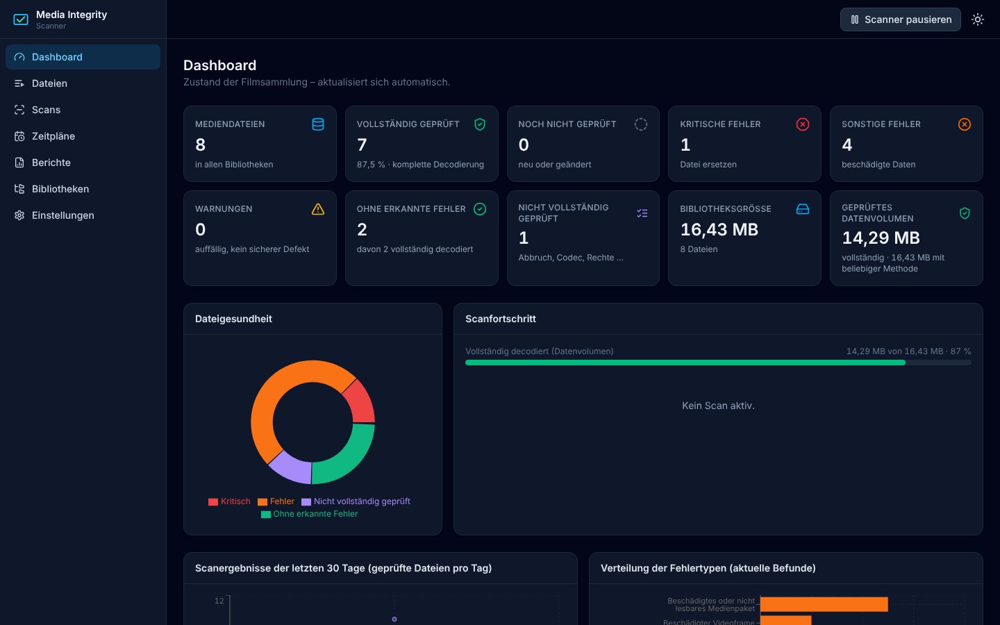
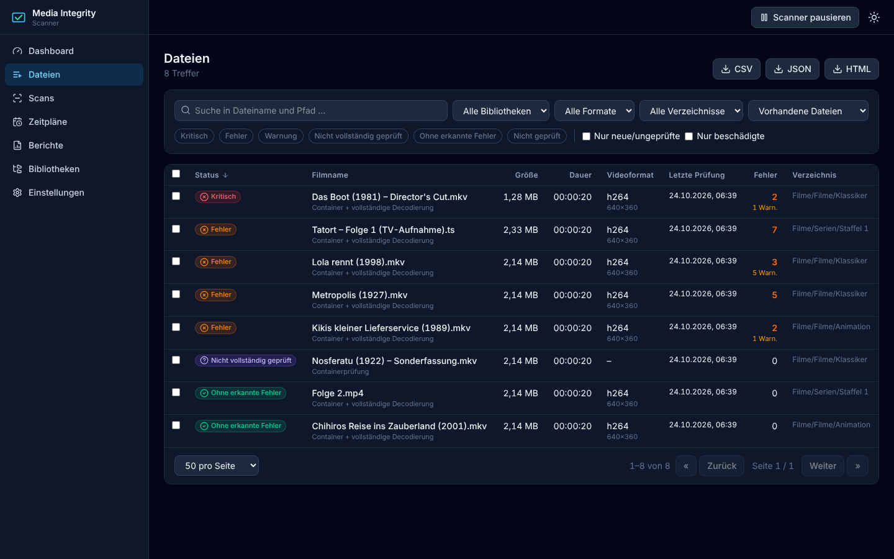
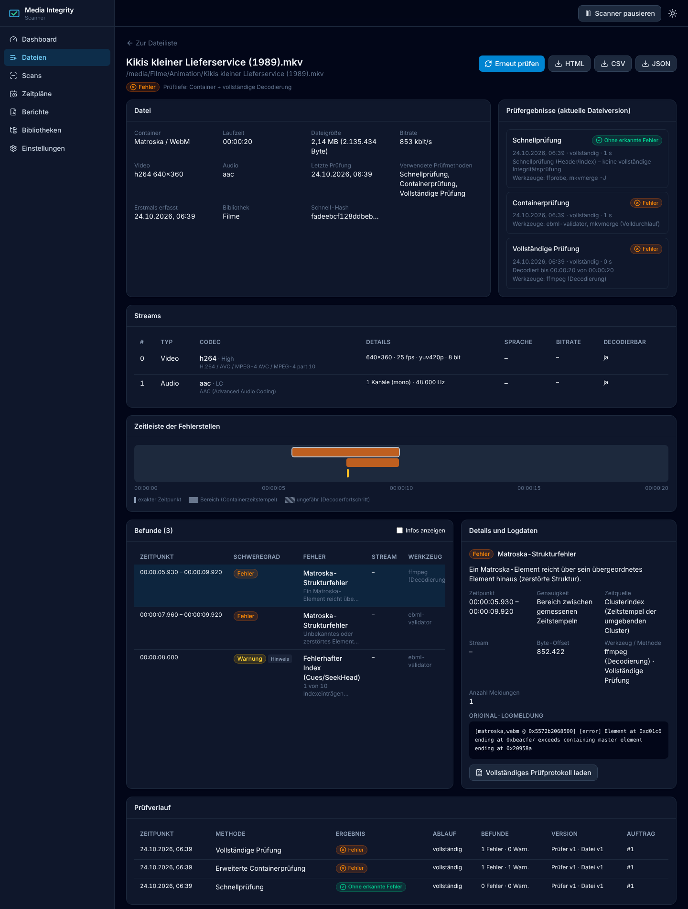
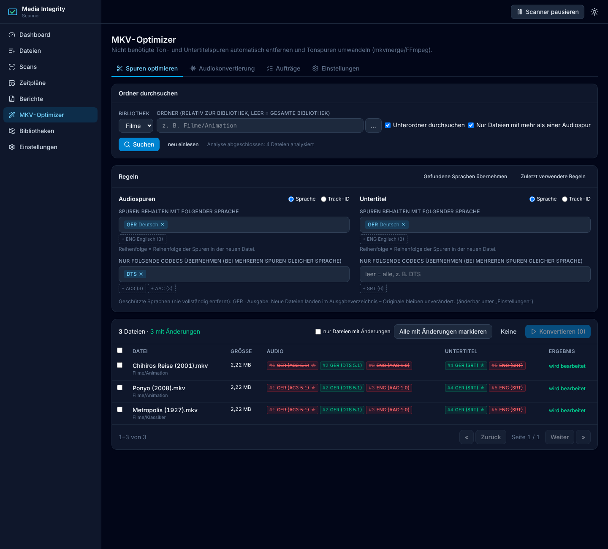
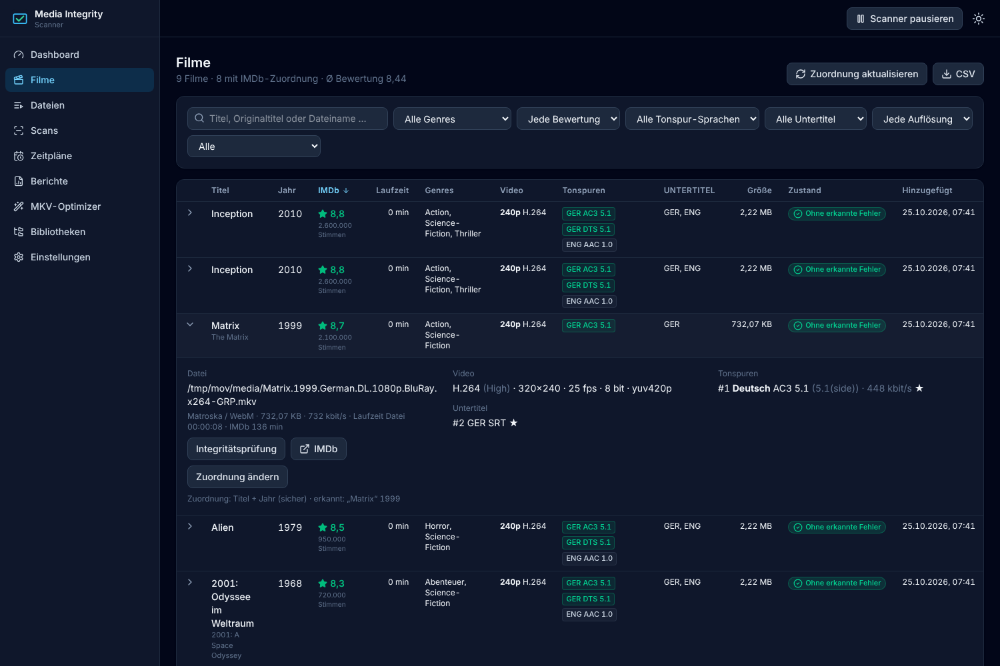

# Media Integrity Scanner

Webanwendung zur Integritätsprüfung großer Filmsammlungen auf **TrueNAS SCALE** (oder jedem anderen Docker-Host).
Sie durchsucht Medienordner rekursiv, prüft MKV, MP4, AVI, MOV, M4V und TS mit drei unabhängig wählbaren
Verfahren und zeigt im Browser, **welche Filme beschädigt sind, wo die Fehler liegen und welche Dateien
bereits vollständig geprüft wurden**.

* Schwerpunkt Matroska: eigener EBML-Strukturprüfer (liest jedes Byte, prüft Cluster, Blöcke, CRC-32,
  Zeitstempel, Cues/SeekHead), `mkvmerge`-Volldurchlauf und vollständige FFmpeg-Decodierung
* Fehlerstellen mit Zeitposition – exakt, als Bereich oder ausdrücklich „nicht bestimmbar“, nie geschätzt
* Medien werden **nur gelesen** (Read-only-Mount, keine Reparatur, keine Umbenennung, keine Löschung)
* ressourcenschonend: 1 Prüfung gleichzeitig, `nice`/`ionice`, begrenzbare Lesegeschwindigkeit, Pause per Klick
* deutsche, responsive Oberfläche mit Dark Mode, Live-Fortschritt ohne Neuladen (Server-Sent Events)
* Zeitpläne, Scanverlauf, Wiederaufnahme nach Neustart, Export als CSV/JSON/HTML



| Dateiliste | Detailansicht mit Zeitleiste |
|---|---|
|  |  |

---

## Inhalt

1. [Schnellstart](#1-schnellstart)
2. [Installation auf TrueNAS SCALE](#2-installation-auf-truenas-scale)
3. [Konfiguration](#3-konfiguration)
4. [Prüfverfahren](#4-prüfverfahren)
5. [Fehlerklassen und Zeitangaben](#5-fehlerklassen-und-zeitangaben)
6. [Bedienung](#6-bedienung)
7. [MKV-Optimizer](#7-mkv-optimizer)
   · [Filmübersicht mit IMDb-Bewertungen](#filmübersicht-mit-imdb-bewertungen)
8. [Bekannte Einschränkungen](#8-bekannte-einschränkungen)
9. [Architektur](#9-architektur)
10. [Tests](#10-tests)
11. [Image bauen und aktualisieren](#11-image-bauen-und-aktualisieren)
12. [Abhängigkeiten](#12-abhängigkeiten)
13. [Sicherheit](#13-sicherheit)

---

## 1. Schnellstart

```bash
git clone <dieses Repository> media-integrity-scanner
cd media-integrity-scanner
# Pfade in docker-compose.yml anpassen (Medien :ro, Konfiguration beschreibbar)
docker compose up -d --build
# Browser: http://<server>:8080
```

Beim ersten Start wird für `/media` automatisch eine Bibliothek „Filme“ angelegt. Unter **Scans → Neuen Scan
starten** die Prüfmethoden wählen und starten.

## 2. Installation auf TrueNAS SCALE

Getestet ist das Image mit Docker 29; TrueNAS SCALE ab 24.10 („Electric Eel“) verwendet Docker Compose für Apps.

### 2.1 Datasets vorbereiten

1. **Medien-Dataset** (z. B. `tank/Filme`) – existiert bereits. Der Scanner braucht nur **Leserechte**.
2. **App-Dataset** für Konfiguration und Datenbank anlegen, z. B. `tank/appdata/media-integrity`.
   Für den MKV-Optimizer zusätzlich ein Ziel-Dataset, z. B. `tank/Filme-optimiert` (Lesen/Schreiben für PUID/PGID).
3. Benutzer festlegen, unter dem der Scanner läuft (PUID/PGID). Empfehlung: einen eigenen Benutzer
   `mediascan` (z. B. UID/GID 3000) anlegen und ihm auf dem Medien-Dataset **Lesen** und auf dem App-Dataset
   **Lesen/Schreiben** geben. Alternativ die vorhandene Gruppe `apps` (GID 568) über
   `SUPPLEMENTARY_GROUPS=568` ergänzen, wenn diese Gruppe bereits Leserecht hat.

### 2.2 Image bereitstellen

TrueNAS kann das Image nicht selbst aus diesem Quellcode bauen. Zwei Wege:

* **Eigene Registry** (empfohlen): auf einem Rechner mit Docker bauen und in eine Registry (z. B. GHCR oder
  eine lokale Registry) pushen – siehe [Abschnitt 11](#11-image-bauen-und-aktualisieren). In TrueNAS dann
  `image: ghcr.io/<konto>/media-integrity-scanner:1.0.0` verwenden.
* **Direkt auf TrueNAS bauen**: per SSH auf dem NAS (`sudo -i`):
  ```bash
  cd /mnt/tank/appdata && git clone <repo> media-integrity-src && cd media-integrity-src
  docker build -t media-integrity-scanner:1.0.0 .
  ```

### 2.3 Custom App anlegen

**Apps → Discover Apps → ⋮ → Install via YAML** und folgendes einfügen (Pfade anpassen):

```yaml
services:
  media-integrity-scanner:
    image: media-integrity-scanner:1.0.0        # bzw. Registry-Pfad
    container_name: media-integrity-scanner
    restart: unless-stopped
    ports:
      - "8080:8080"
    environment:
      TZ: Europe/Berlin
      PUID: "3000"
      PGID: "3000"
      MAX_CONCURRENT_SCANS: "1"
    volumes:
      - /mnt/tank/Filme:/media:ro
      - /mnt/tank/appdata/media-integrity:/config
      - /mnt/tank/Filme-optimiert:/output       # nur für den MKV-Optimizer
    stop_grace_period: 30s
    security_opt:
      - no-new-privileges:true
    healthcheck:
      test: ["CMD", "python", "-c", "import urllib.request; urllib.request.urlopen('http://127.0.0.1:8080/health', timeout=5)"]
      interval: 30s
      timeout: 10s
      retries: 3
```

Mehrere Medien-Datasets: weitere Mounts unterhalb von `/media` anlegen (z. B. `/mnt/tank/Serien:/media/Serien:ro`)
und in der Oberfläche unter **Bibliotheken** als eigene Bibliothek hinzufügen.

> **Wichtig:** Das Medienverzeichnis immer mit `:ro` einbinden. Die Oberfläche warnt unter *Einstellungen → System*,
> wenn es beschreibbar ist. Der Scanner schreibt ohnehin nie in Medienverzeichnisse.

### 2.4 Kontrolle nach dem Start

* `docker logs media-integrity-scanner` zeigt Werkzeugversionen sowie UID/GID.
* *Einstellungen → System* zeigt FFmpeg/MKVToolNix-Versionen und ob `/media` schreibgeschützt ist.
* Erscheinen Dateien als „Nicht vollständig geprüft – keine Leseberechtigung“, fehlen dem PUID/PGID-Benutzer
  Rechte auf dem Dataset (ACL prüfen).

## 3. Konfiguration

### 3.1 Umgebungsvariablen

| Variable | Standard | Bedeutung |
|---|---|---|
| `PUID` / `PGID` | `3000` | Benutzer/Gruppe, unter dem die Anwendung läuft (wird per `setpriv` gesetzt) |
| `SUPPLEMENTARY_GROUPS` | – | Zusätzliche Gruppen-IDs, kommagetrennt (z. B. `568`) |
| `TZ` | `Europe/Berlin` | Zeitzone für Anzeige und Zeitpläne |
| `MAX_CONCURRENT_SCANS` | `1` | Startwert für parallele Dateiprüfungen (in der Oberfläche änderbar) |
| `FFMPEG_THREADS` | `2` | Decoder-Threads je Prüfung (`0` = alle Kerne) |
| `NICE_LEVEL` | `10` | CPU-Priorität der Prüfwerkzeuge (0–19) |
| `IO_PRIORITY` | `best-effort-low` | `idle`, `best-effort-low`, `best-effort`, `normal` |
| `MEDIA_ROOT` | `/media` | Erlaubte Medienwurzel(n), mehrere mit `:` trennen |
| `CONFIG_DIR` | `/config` | Datenbank, Logs, Schlüssel |
| `AUTO_CREATE_LIBRARY` | `true` | Beim ersten Start Bibliothek für die Medienwurzel anlegen |
| `AUTH_ENABLED`, `AUTH_USERNAME`, `AUTH_PASSWORD` | – | Optionale Anmeldung (hat Vorrang vor der Oberfläche) |
| `REPAIR_ENABLED` | `false` | Vorbereitete Reparaturfunktion freischalten (siehe 13) |
| `SCAN_TMP_DIR` | `/config/tmp` | Temporärer Speicher für den optionalen Diagnose-Remux |
| `OPTIMIZER_OUTPUT_DIR` | `/output` | Ausgabeverzeichnis des MKV-Optimizers (Volume einbinden) |
| `IMDB_DATASET_URL` | `https://datasets.imdbws.com` | Quelle der IMDb-Datensätze (z. B. interner Spiegel) |
| `PORT` | `8080` | Port im Container |
| `LOG_LEVEL` | `INFO` | Protokollstufe |

Eine kommentierte Vorlage liegt in [`.env.example`](.env.example).

### 3.2 Einstellungen in der Oberfläche (persistent in `/config`)

* **Ressourcen:** parallele Prüfungen, FFmpeg-Threads, `nice`, `ionice`, Lesegeschwindigkeit
  (`-readrate`, Vielfaches der Abspielgeschwindigkeit), Hardwarebeschleunigung (Standard: aus), Pausenmodus
  (sofort oder nach der aktuellen Datei), Hänger-Erkennung.
* **Prüfverfahren:** Standardmethoden, Teilverfahren der Containerprüfung, Diagnose-Remux, strenge
  Decoderprüfung, Schwellwerte für Zeitstempelsprünge, Spurlücken und Laufzeittoleranz.
* **Dateierkennung:** Dateiendungen, globale Ausschlussmuster (fnmatch auf Name oder relativen Pfad; Standard
  u. a. `@eaDir`, `#recycle`, `.Trash-*`, `*.part`, versteckte Dateien), Hash-Modus, Symlinks.
* **Anmeldung:** Benutzer und Passwort (scrypt-Hash).

### 3.3 Verzeichnisse in `/config`

```
/config/media-integrity.db      SQLite-Datenbank (WAL)
/config/secret.key              Schlüssel für Sitzungs-Cookies
/config/logs/app.log            Anwendungsprotokoll (rotierend, 5 × 10 MB)
/config/logs/scans/<id>/…gz     vollständige FFmpeg-Protokolle der Decodierprüfungen
/config/tmp/                    temporäre Dateien (Diagnose-Remux)
/config/repaired/               nur bei REPAIR_ENABLED: neue, reparierte Dateien
```

## 4. Prüfverfahren

Alle Verfahren laufen als eigene Prozesse mit sicheren Argumentlisten (kein Shell), niedriger CPU- und
E/A-Priorität und können pausiert (SIGSTOP/SIGCONT) oder abgebrochen werden. Vor und nach jeder Prüfung werden
Größe, Änderungszeit und Inode verglichen.

### Modus A – Schnellprüfung (Bestandsaufnahme)

`ffprobe -show_format -show_streams -show_chapters -show_error` und für Matroska `mkvmerge -J`.
Geprüft werden Lesbarkeit, Container, Codecs, Laufzeit, Streamparameter, widersprüchliche Angaben (z. B.
Laufzeit laut Container vs. Stream, Spurenzahl FFprobe vs. mkvmerge) und Meldungen beim Öffnen.

**Grenze:** Es werden nur Header und Index gelesen. Die Schnellprüfung ist **keine Integritätsprüfung**; ein
fehlerfreies Ergebnis wird als „Ohne erkannte Fehler – noch keine vollständige Decodierprüfung“ angezeigt und
zählt nicht als „vollständig geprüft“.

### Modus B – Erweiterte Containerprüfung

Für Matroska werden drei voneinander unabhängige Durchläufe über die **gesamte Datei** kombiniert:

1. **EBML-Strukturprüfer** (eigener, streamender Parser, `backend/app/scanners/ebml.py`)
   * liest jedes Byte (auch Blockinhalte) → E/A-Fehler und nicht lesbare Bereiche werden gefunden
   * EBML-Header, DocType, Segmentgröße gegenüber Dateigröße (abgeschnittene Dateien)
   * jedes Level-1-Element; zerstörte Bereiche werden übersprungen und per Resynchronisation exakt eingegrenzt
   * jeder Cluster: erlaubte Kindelemente, Elementgrenzen, Clusterzeitstempel
   * jeder (Simple)Block: Spurnummer gegen `Tracks`, Blockkopf, Xiph/EBML/Fixed-Lacing
   * **CRC-32**: enthält ein Cluster ein CRC-Element (FFmpeg schreibt es standardmäßig), wird es nachgerechnet
     → auch einzelne gekippte Bytes in Bild-/Tondaten werden erkannt
   * Zeitstempel: rückwärts laufende Cluster, Sprünge (die typische Ursache für „springt ans Ende“), Lücken in
     Video-/Audiospuren, rückwärts laufende Audiozeitstempel
   * Laufzeit laut Segment-Info gegen die tatsächlichen letzten Blockzeitstempel
   * Index: jeder `CuePoint` muss auf einen tatsächlichen Clusteranfang zeigen; `SeekHead`-Einträge müssen auf
     das angegebene Element zeigen
2. **mkvmerge-Volldurchlauf**: `mkvmerge --gui-mode -o /dev/null <datei>` liest und multiplext alle Blöcke über
   MKVToolNix, ohne etwas zu schreiben. Ausgewertet werden u. a. „Error in the Matroska file structure at
   position …“, die Resync-Position und die von mkvmerge genannten Zeitstempel vor/nach dem Fehler. Die
   Warnung „Updating the 'document type version' … failed“ entsteht nur durch die Ausgabe nach `/dev/null` und
   wird ignoriert. `mkvmerge -J` (reine Identifikation) wird hierfür bewusst **nicht** verwendet.
3. **FFmpeg-Demux-Durchlauf**: `ffmpeg -i <datei> -map … -c copy -f null -` liest alle Pakete über den
   FFmpeg-Demuxer. Läuft im selben Auftrag auch Modus C, wird dieser Durchlauf eingespart, weil die
   Decodierung den Demuxer ohnehin vollständig durchläuft.

Befunde, die mehrere Werkzeuge an derselben Byteposition melden, werden zusammengeführt („bestätigt durch …“).

Optional: **Diagnose-Remux** mit mkvmerge in eine temporäre Datei unter `/config/tmp` (nur bei ausreichend
Speicher), Vergleich der Laufzeit, anschließend Löschung. Das Original wird nie geschrieben.

Für MP4/MOV/M4V/AVI/TS besteht Modus B aus dem FFmpeg-Demux-Durchlauf (u. a. fehlendes `moov`-Atom, „partial
file“, Paketfehler mit DTS, Kontinuitätsfehler).

**Grenzen:** siehe [Abschnitt 8](#8-bekannte-einschränkungen).

### Modus C – Vollständige Prüfung (Decodierung)

```
ffmpeg -nostdin -loglevel repeat+level+warning -progress pipe:1 -stats_period 0.5 \
       -threads N [-hwaccel X] [-err_detect crccheck+bitstream+buffer] [-readrate R] \
       -i file:<datei> -map 0:<jeder decodierbare Video-/Audiostream> -f null -
```

* Die Datei wird vollständig gelesen, **alle unterstützten Video- und Audiostreams werden decodiert** und
  verworfen. Es wird nichts neu codiert und nichts geschrieben.
* Stderr wird **zeilenweise vollständig** ausgewertet – auch wenn FFmpeg mit Exit-Code 0 endet. Wiederholte
  Meldungen werden zu einem Befund mit Anzahl und Zeitbereich zusammengefasst; das vollständige Protokoll wird
  komprimiert gespeichert und ist in der Detailansicht abrufbar.
* Erkannt werden u. a. Makroblock-/Slice-Fehler, Fehlerverschleierung, `corrupt decoded frame`,
  Audiodecoderfehler (AAC, AC-3, DTS, MP3 …), beschädigte Pakete, Demux-Fehler, vorzeitiges Dateiende,
  Abbrüche (Exit-Code ≠ 0) und Laufzeitabweichungen (decodierte Dauer gegen Containerlaufzeit).
* Streams mit Codecs ohne Decoder werden nicht gemappt und als „nicht prüfbar – kein Defektnachweis“
  vermerkt.
* Abbruch durch den Benutzer, Neustart, Werkzeugabsturz (z. B. Signal 9 durch Speichermangel) und hängende
  Werkzeuge werden getrennt von echten Datenfehlern erfasst.
* Eine Datei gilt nur dann als „Ohne erkannte Fehler“, wenn **alle gewählten Prüfungen vollständig**
  abgeschlossen wurden.

Optional „Hash-Modus: vollständig“: SHA-256 über die ganze Datei bei Container-/Vollprüfung. Ändert sich der
Inhalt bei gleicher Größe und Änderungszeit, wird stille Datenveränderung (Bitrot) gemeldet.

### Prüferversionen und inkrementelle Scans

Jedes Ergebnis speichert Methode, Prüferversion, Werkzeugversionen und die Dateiversion
(Größe + Änderungszeit, intern `fingerprint_version`). Ein inkrementeller Scan überspringt eine Datei nur,
wenn für **dieselbe Methode** ein vollständig abgeschlossenes Ergebnis für **dieselbe Dateiversion** und
**dieselbe Prüferversion** vorliegt. Eine Schnellprüfung ersetzt also nie eine Decodierprüfung.

## 5. Fehlerklassen und Zeitangaben

| Status | Bedeutung | Beispiele |
|---|---|---|
| **Kritisch** | Datei nicht oder nur teilweise abspielbar | nicht lesbar, EBML-Header zerstört, abgeschnitten, E/A-Fehler, Decodierung bricht ab, keine Resynchronisation möglich |
| **Fehler** | beschädigte Daten nachgewiesen | beschädigte Cluster/Videoframes, Audiodecodierungsfehler, CRC falsch, Paketfehler, Zeitstempelsprung ≥ 30 s, Cluster, die ≥ 1 s rückwärts springen |
| **Warnung** | auffällig, **kein sicherer Defektnachweis** | Laufzeitabweichung, Sprünge ≥ 3 s, Spurlücken, inkonsistente Metadaten, ungültige Cues, nicht klassifizierte Werkzeugwarnungen |
| **Ohne erkannte Fehler** | alle gewählten Prüfungen vollständig, keine relevanten Befunde | – |
| **Nicht vollständig geprüft** | kein Urteil möglich | abgebrochen, Datei während der Prüfung verändert, Werkzeug fehlgeschlagen, Codec nicht unterstützt, keine Leserechte |

Heuristische Befunde sind in Oberfläche und Berichten als „Hinweis“ markiert. Unbekannte Werkzeugmeldungen
werden nie als Fehler gewertet, sondern als nicht eindeutige Warnung (Decoder/Demuxer) oder nur protokolliert.
Ein **nicht unterstützter Codec** ist ausdrücklich kein Defekt (Status „Nicht vollständig geprüft“).

**Rückwärts laufende Clusterzeitstempel:** Ein Cluster darf mit einem Block beginnen, der etwas vor dem
ersten Block des vorigen Clusters liegt (verschachtelte Audio-/Videospuren). Bis Containerprüfer-Version 1
wurde das als Fehler gemeldet – das betraf fast jeden 4K-Remux. Ab Version 2 gilt ein Rücksprung unter 1 s
als zulässig (nur noch protokolliert). Bei einem inkrementellen Scan werden betroffene Dateien automatisch
neu geprüft, weil sich die Prüferversion geändert hat.

### Reparaturbewertung und Reparaturlisten

Jede Datei bekommt aus ihren Befunden eine **Empfehlung** (Detailseite, Spalte „Empfehlung“ in allen
CSV-Exporten). Die Bewertung legt die gespeicherten Befunde nur aus; sie verändert keine Prüfergebnisse.

| Empfehlung | Bedeutung | typische Befunde |
|---|---|---|
| **Nicht mehr reparierbar** | Daten fehlen oder sind zerstört → neu beschaffen/neu rippen | beschädigte Cluster, CRC-Fehler, E/A-Fehler, abgeschnitten, Bild-/Decodierfehler, Lücke ≥ 10 s, Ende fehlt ≥ 10 s, Rücksprung ≥ 10 s |
| **Reparatur empfohlen** | Struktur ohne Datenverlust → Remux mit mkvmerge | fehlerhafter Index (Cues/SeekHead), Daten nach Segmentende, falsche Laufzeitangabe, Rücksprünge 1–10 s |
| **Kleinere Auffälligkeiten** | abspielbar, Remux optional | ungeordnete Paketzeitstempel, kurze Spurrücksprünge, Decoderwarnungen |
| **Nicht ausreichend geprüft** | kein Urteil möglich | abgebrochen, Werkzeug fehlgeschlagen |
| **Kein Handlungsbedarf** | keine oder nur harmlose Meldungen | PGS-Untertitel ohne Startpaket, Dolby-Vision-Zusatzdaten („Block Addition“), gleiche DTS bei TrueHD/E-AC-3, MPEG-2 „ignoring pic cod ext“ |

Unter **Berichte** gibt es dafür drei Listen: *Nicht mehr reparierbar*, *Sollten repariert werden* und
die *Reparaturübersicht* (alle Dateien nach Empfehlung gruppiert, als HTML mit Summen je Gruppe).
API: `/api/export?scope=replace|repair|assessment&format=csv|json|html`.

CSV mit Semikolon schreibt Zahlen mit Dezimalkomma und drei Nachkommastellen, damit Excel (deutsch) sie
nicht als Datum („3.67“ → „Mrz 67“) oder Tausenderzahl liest.

**Zeitangaben** werden nie aus Byte-Offsets oder Bitraten geschätzt:

| Genauigkeit | Quelle | Zeitleiste |
|---|---|---|
| exakt | Cluster-/Blockzeitstempel, DTS eines Pakets, von mkvmerge genannte Zeitstempel | Strich |
| Bereich | zwischen zwei gemessenen Zeitstempeln (z. B. letzter gültiger Block bis nächster Cluster; Byte-Offset → umgebende Cluster aus dem tatsächlich gelesenen Clusterindex) | Band |
| ungefähr | Decoderfehler tragen keine Zeitstempel; sie werden dem FFmpeg-Fortschritt (`out_time`) zugeordnet | schraffiertes Band, „ca.“ |
| nicht bestimmbar | keine Messgröße vorhanden | **nicht** eingezeichnet, ausdrücklich gekennzeichnet |

## 6. Bedienung

* **Dashboard:** Kennzahlen (alle anklickbar → gefilterte Dateiliste), Kreisdiagramm Dateigesundheit, Verlauf
  der letzten 30 Tage, Fehlertypverteilung, laufende Scans, Speicherplatz. Aktualisierung live.
* **Dateien:** serverseitig paginierte, sortierbare Tabelle (auch für zehntausende Dateien), Volltextsuche,
  Filter nach Status, Format, Verzeichnis, Bibliothek, „nur neue“, „nur beschädigte“, nicht mehr vorhandene
  Dateien; Mehrfachauswahl (auch „alle Treffer“) → **Erneut prüfen**; Export der aktuellen Filterung.
* **Detailansicht:** Datei- und Streaminformationen, Ergebnis je Methode, Zeitleiste über die Filmlänge
  (Klick auf eine Markierung zeigt Beschreibung, Werkzeug, Byte-Offset und Originalmeldungen), chronologische
  Befundliste, vollständiges FFmpeg-Protokoll, Prüfverlauf, Export.
* **Scans:** neue Scans (inkrementell, nur neue, nur geänderte, fehlerhafte erneut, vollständig erneut),
  Priorität, laufende Scans mit aktueller Datei, Datei- und Gesamtfortschritt, geprüfter Datenmenge,
  Geschwindigkeit, Restdauer, Fehleranzahl und Parallelität; Pausieren/Fortsetzen/Abbrechen; Verlauf mit
  Ereignisprotokoll je Auftrag.
* **Zeitpläne:** täglich, wöchentlich, monatlich, benutzerdefiniert (Cron); Aufgaben „neue“, „geänderte“,
  „neue und geänderte“, „vollständig erneut“, „fehlerhafte nachprüfen“.
* **Berichte:** CSV (UTF-8 mit BOM, Semikolon – öffnet in Excel mit Umlauten), JSON, HTML.
  Beispiele: [`docs/beispielberichte/`](docs/beispielberichte/).
* **Scanner pausieren** (Kopfzeile): hält sofort alle Prüfungen an, z. B. wenn das NAS anderweitig gebraucht
  wird.

### Pausieren, Abbrechen, Neustart

* *Sofort pausieren* hält FFmpeg/mkvmerge/den Strukturprüfer per `SIGSTOP` an; nach `SIGCONT` geht es exakt an
  derselben Stelle weiter. Alternativ: *nach der aktuellen Datei* pausieren.
* *Abbrechen* beendet die Werkzeuge; die Datei erhält das Ergebnis „abgebrochen“ (nicht vollständig geprüft),
  ein früheres vollständiges Ergebnis bleibt gültig.
* Bei `docker stop` werden laufende Prüfungen als „unterbrochen“ protokolliert. Nach dem Start (auch nach
  `kill -9`/Stromausfall) werden laufende Aufträge erkannt, unterbrochene Dateien zurückgesetzt und der Auftrag
  fortgesetzt (abschaltbar). Das Auftragsprotokoll vermerkt jeden Neustart.
* Doppelte Aufträge sind ausgeschlossen: Ein eindeutiger Teilindex in SQLite verhindert zwei aktive Aufträge
  mit identischen Parametern; fällige Zeitpläne werden atomar genau einmal ausgelöst und verpasste Termine nach
  einem Neustart höchstens einmal nachgeholt.

## 7. MKV-Optimizer

Entfernt nicht benötigte Ton- und Untertitelspuren aus MKV-Dateien – automatisch nach Regeln – und
konvertiert Tonspuren (z. B. DTS/TrueHD → AC3). Erreichbar über **MKV-Optimizer** in der Navigation.
MKVToolNix und FFmpeg sind im Image enthalten, eine Pfadangabe ist nicht nötig.

> Dieser Teil **schreibt Dateien**. Standardmäßig entstehen ausschließlich **neue Dateien im Ausgabeverzeichnis**
> `/output`; Medien bleiben schreibgeschützt (`:ro`). Originale werden nur verändert, wenn das in den
> Einstellungen ausdrücklich freigegeben und das Medienverzeichnis beschreibbar eingebunden ist.



### 7.1 Spuren optimieren

1. Bibliothek und Ordner wählen (Eingabe, „…“-Auswahldialog oder Pfad per Drag & Drop als Text), *Unterordner
   durchsuchen* und *Nur Dateien mit mehr als einer Audiospur* sind voreingestellt.
2. **Suchen**: Alle MKVs werden mit `mkvmerge -J` analysiert (Ergebnis wird je Dateiversion zwischengespeichert,
   unveränderte Dateien werden beim nächsten Mal nicht erneut gelesen).
3. **Regeln** für Audio und Untertitel:
   * *Sprache*: „Spuren behalten mit folgender Sprache“ ist nach dem Suchen mit allen gefundenen Sprachen
     belegt – nicht gewünschte einfach entfernen. Die Reihenfolge bestimmt die Spurreihenfolge in der neuen Datei.
   * *Nur folgende Codecs übernehmen*: Gibt es mehrere Spuren derselben Sprache (z. B. GER AC3 und GER DTS),
     bleiben nur die mit passendem Codec. Passt keine, bleiben alle Spuren dieser Sprache erhalten.
   * *Track-ID*: feste mkvmerge-Track-IDs, durch Komma getrennt (z. B. `1, 3`).
   * Leere Untertitelliste = alle Untertitel entfernen.
4. Die Liste zeigt je Datei alle Spuren: grün = bleibt, rot durchgestrichen = wird entfernt, ★ = Standardspur.
   **Doppelklick** auf eine Datei zeigt Spurtabelle, Begründung je Spur, Ziel und den exakten mkvmerge-Befehl
   (Ersatz für das Öffnen der mkvmerge-GUI). **Rechtsklick** öffnet ein Kontextmenü zum Markieren.
5. Dateien markieren → **Konvertieren**. mkvmerge schreibt ohne Neucodierung.

**Vorhersage der Ersparnis:** Die Spalte „Ersparnis“ und die Zusammenfassung über der Liste zeigen, wie viel
Speicher das Entfernen der Spuren voraussichtlich freigibt – für alle Dateien mit Änderungen und für die markierten.
Grundlage sind die tatsächlichen Spurgrößen, ohne die Datei komplett zu lesen:

* **exakt** aus den Statistik-Tags (`NUMBER_OF_BYTES`), die mkvmerge in nahezu jede MKV schreibt,
* **ca.** aus Bitrate × Laufzeit bei Codecs mit konstanter Bitrate (AC3, E-AC3, DTS, PCM),
* Spuren ohne beide Angaben (z. B. AAC aus FFmpeg ohne Tags) werden nicht geschätzt und als „unbek.“ ausgewiesen.

Die Abweichung zur tatsächlichen Ersparnis entsteht nur durch Container-Overhead (Blockköpfe, Index) und liegt
bei exakten Angaben typischerweise unter 1 %. Bei der Audiokonvertierung wird die neue Größe aus Zielbitrate ×
Laufzeit geschätzt („+ … größer“ bei zusätzlichen Spuren). Im Auftrag stehen Vorhersage und tatsächliche
Ersparnis je Datei nebeneinander. Im Modus „Ausgabeverzeichnis“ bzw. „neben dem Original“ wird der Speicher erst
frei, wenn die Originale ersetzt werden.

Sicherheitsregeln: Eine Datei wird nie ohne Audiospur geschrieben; *geschützte Sprachen* (Standard: GER) werden
nie vollständig entfernt; Dateien ohne Änderung werden nicht angefasst; wird die bisherige Standard-Audiospur
entfernt, wird die erste verbleibende Spur Standard (abschaltbar).

### 7.2 Audiokonvertierung

Ordner wählen, **Profil** auswählen, **Suchen**, Dateien markieren, **Konvertieren**. Je Datei zeigt die Liste, welche
Spur wohin umgewandelt wird. FFmpeg codiert nur die betroffenen Spuren in temporäre Dateien, anschließend setzt
mkvmerge die MKV verlustfrei neu zusammen (Kapitel, Anhänge, Tags, Untertitel und Spurflags bleiben erhalten).
Die konvertierte Spur steht an der Position der Originalspur (*ersetzen*) bzw. direkt dahinter (*zusätzlich*)
und übernimmt Sprache und Standard-Flag.

Vordefinierte Profile: DTS/TrueHD → AC3 5.1 640 kbit/s (ersetzen bzw. zusätzlich), DTS/TrueHD → E-AC3
1024 kbit/s, FLAC/PCM → AC3 5.1, alle Spuren → AAC-Stereo-Downmix (zusätzlich). Eigene Profile:
Zielcodec (AC3, E-AC3, AAC, FLAC, Opus, MP3), Bitrate, maximale Kanalzahl (Downmix), Abtastrate,
Quellcodecs und -sprachen, Modus, Spurname (`{codec}`, `{channels}`, `{lang}`) und Dateiname der neuen Datei
(`{name}`, `{codec}`, `{profile}`).

### 7.3 Aufträge

Jede Konvertierung läuft als Auftrag im Hintergrund (eine Datei gleichzeitig, niedrige CPU-/E/A-Priorität):
Fortschritt und Restdauer **je Datei und gesamt**, eingesparter Speicher, Pausieren (sofort per SIGSTOP),
Fortsetzen, Abbrechen, Protokoll je Datei mit den ausgeführten Befehlen. Nach einem Neustart werden temporäre
Dateien gelöscht und der Auftrag fortgesetzt. Der Integritätsscanner prüft eine Datei nie, während der
Optimizer sie bearbeitet; „Scanner pausieren“ hält auch den Optimizer an.

### 7.4 Dateioperationen (MKV-Optimizer → Einstellungen)

| Modus | Ergebnis | Voraussetzung |
|---|---|---|
| Neue Datei im Ausgabeverzeichnis (Standard) | `/output/<gleicher Pfad wie unter /media>` | Volume `/output` beschreibbar |
| Neue Datei neben dem Original | `Film.optimiert.mkv` (Suffix einstellbar) bzw. Profil-Dateiname | `/media` beschreibbar |
| Original ersetzen, Original sichern | Original wird nach `<Bibliothek>/.mis-originale/<Pfad>` verschoben | `/media` beschreibbar + Freigabe |
| Original ersetzen und löschen | Original wird ersetzt | `/media` beschreibbar + Freigabe |

Ablauf jeder Bearbeitung: Spuren neu einlesen (Plan wird mit den aktuellen Spuren berechnet) → in eine
versteckte temporäre Datei im Zielordner schreiben → **prüfen** (Spuren und Codecs wie geplant, Laufzeit gleich,
EBML-Strukturprüfung ohne Fehler) → erst dann abschließen. Neue Dateien überschreiben nie eine bestehende Datei
(`Film (2).mkv`). Beim Ersetzen wird zusätzlich geprüft, ob sich das Original währenddessen verändert hat;
das Ersetzen erfolgt per atomarem Umbenennen im selben Dateisystem. Dateien mit Integritätsfehlern werden
standardmäßig übersprungen. Ersetzte Dateien werden in der Bibliothek als geändert markiert und beim nächsten
inkrementellen Scan erneut geprüft.

Weitere Optionen: Metadaten entfernen (globale Tags, Spur-Tags, Titel), Spuren nach Sprachreihenfolge
neu sortieren, Standard-Audiospur setzen, geschützte Sprachen, Ergebnisprüfung, beschädigte Dateien überspringen.

Compose-Beispiel für Ersetzen am Original (bewusst ohne `:ro`):

```yaml
    volumes:
      - /mnt/tank/Filme:/media          # beschreibbar – nur wenn Originale ersetzt werden sollen
      - /mnt/tank/appdata/media-integrity:/config
```

### 7.5 Unterschiede zum Windows-Programm „MKV Optimizer“

* Weboberfläche statt Desktopprogramm; Ordner werden innerhalb der eingebundenen Bibliotheken gewählt
  (Drag & Drop eines Ordners aus dem Dateimanager des eigenen PCs ist im Browser nicht möglich).
* Statt die mkvmerge-GUI zu öffnen, zeigt der Doppelklick Spurdetails und den exakten Befehl.
* Die Oberfläche ist deutsch; eine englische Übersetzung ist nicht enthalten.
* Werkzeugsuche/-pfade entfallen, weil MKVToolNix und FFmpeg im Image enthalten sind.

### Filmübersicht mit IMDb-Bewertungen



Menüpunkt **Filme**: alle Filme als Tabelle mit Titel (deutscher Titel, darunter Originaltitel), Jahr,
**IMDb-Bewertung** und Stimmenzahl, Laufzeit, Genres, Video (Auflösung, Codec, 10 bit), allen **Tonspuren**
(Sprache, Codec, Kanäle – deutsche Spuren hervorgehoben), Untertitelsprachen, Größe, Integritätszustand und
Datum der Aufnahme. **Jede Spalte ist per Klick sortierbar** (erneuter Klick kehrt die Reihenfolge um), auch nach
Bewertung, Stimmen, Auflösung und Anzahl der Tonspuren; Filme ohne Bewertung stehen immer am Ende. Filter: Suche
(Titel, Originaltitel, Dateiname), Genre, Mindestbewertung, Tonspur- und Untertitelsprache, Auflösung, mit/ohne
IMDb-Zuordnung, Bibliothek. Ein Klick auf eine Zeile zeigt alle Details (Spurnamen, Bitraten, Kanallayout,
IMDb-Link, Art der Zuordnung). Die gefilterte und sortierte Liste lässt sich als CSV exportieren.

Tonspuren und Metadaten stammen aus der Schnellprüfung; noch nicht eingelesene Dateien werden angezeigt und
lassen sich mit „Metadaten einlesen“ nachholen.

**Bewertungen** kommen aus den offiziellen **IMDb-Datensätzen** (`datasets.imdbws.com`, nur für private,
nicht-kommerzielle Nutzung): Ein Klick lädt `title.basics`, `title.ratings` und optional `title.akas`
(deutsche Titel) herunter und importiert sie in `/config/imdb.db` – danach läuft jeder Abgleich lokal, ohne
API-Schlüssel und ohne Anfrage je Film. Ohne Internetzugang am NAS die drei Dateien manuell nach `/config/imdb/`
kopieren und „Lokale Dateien importieren“ wählen. Eine fehlgeschlagene Aktualisierung lässt die bisherigen
Daten unverändert (Import in eine temporäre Datei, dann atomarer Austausch). Für aktuelle Bewertungen gelegentlich
„jetzt aktualisieren“ wählen.

Zuordnung Datei → IMDb (in dieser Reihenfolge):

1. **manuell** in der Oberfläche („Zuordnung ändern“: Kandidatensuche nach Titel/Jahr oder IMDb-ID, auch
   „Keine Zuordnung“) – bleibt bei späteren Läufen erhalten,
2. IMDb-ID aus einer **.nfo-Datei** (`<film>.nfo` oder `movie.nfo`, Kodi/Jellyfin/Emby),
3. IMDb-ID im **Datei- oder Ordnernamen** (`… [tt1234567].mkv`),
4. **Titel + Jahr** aus dem Datei- bzw. Ordnernamen (Release-Angaben wie `1080p`, `German`, `BluRay` werden
   entfernt), verglichen mit Original-, internationalem und deutschem Titel; Umlaute, Akzente und Satzzeichen
   werden dabei vereinheitlicht. Die Sicherheit wird angezeigt (sicher / wahrscheinlich / unsicher ohne Jahr /
   mehrdeutig – mehrdeutige Treffer werden nicht automatisch übernommen).

## 8. Bekannte Einschränkungen

* **Decodierbarkeit ≠ Bildqualität.** Ein formal gültiger, aber inhaltlich falscher Frame (z. B. grüne Blöcke
  aus einer fehlerhaften Quelle) wird nur erkannt, wenn der Decoder ihn als fehlerhaft meldet.
* **Zeitposition von Decoderfehlern** ist nur ungefähr (FFmpeg meldet keine Zeitstempel zu Decoderfehlern).
  Exakte Positionen liefern Strukturprüfung, CRC, DTS-Meldungen und mkvmerge.
* **CRC-Prüfung** nur, wenn der Muxer CRC-32-Elemente geschrieben hat (FFmpeg: ja; mkvmerge: standardmäßig nein).
  Ohne CRC erkennt Modus B gekippte Bytes in Nutzdaten nicht – dafür ist Modus C da.
* Unbekannte oder fehlerhafte **Video-/Audio-Codecs** können nicht decodiert werden; diese Streams bleiben
  ungeprüft (Status „Nicht vollständig geprüft“).
* **MP4/AVI/TS** haben keine eigene Strukturprüfung wie Matroska; Modus B nutzt dort den FFmpeg-Demuxer.
* Untertitel werden nicht decodiert (nur demuxt).
* **Hardwarebeschleunigung** ist optional und nicht getestet; Hardwaredecoder melden Fehler teils nicht oder
  anders. Standard ist Softwaredecodierung. Für VAAPI/QSV muss `/dev/dri` in den Container durchgereicht werden.
* Zeitstempelsprünge, Spurlücken und Laufzeitabweichungen sind Heuristiken mit einstellbaren Schwellwerten
  (Werbepausen in TV-Aufnahmen, kapitelweise zusammengesetzte Dateien u. Ä. können legitim sein).
* Der Scanner läuft mit **einem** Server-Prozess (`--workers 1`); mehr Worker würden die Auftragssteuerung
  duplizieren.
* **Verschiebeerkennung** über Größe + Änderungszeit + Schnell-Hash (3 × 64 KiB). Kopien, die die
  Änderungszeit nicht erhalten, gelten als neue Dateien.
* **arm64:** Das Dockerfile ist für `linux/amd64` und `linux/arm64` ausgelegt (alle Pakete sind für beide
  Architekturen in Ubuntu 24.04 verfügbar). Gebaut und getestet wurde in der Entwicklungsumgebung nur
  `linux/amd64`; der GitHub-Actions-Workflow baut beide Architekturen.
* **MKV-Optimizer:** nur MKV-Dateien. Die Spurzuordnung zwischen mkvmerge und FFmpeg wird vor jeder
  Audiokonvertierung geprüft; Dateien, bei denen sie nicht eindeutig ist, werden nicht bearbeitet. Ersetzen am
  Original setzt voraus, dass Sicherungsordner und Datei im selben Dataset liegen (atomares Umbenennen).
  Eine Konvertierung verlustbehafteter Formate ist naturgemäß nicht verlustfrei.
* **IMDb:** Der Download benötigt Internetzugang des Containers zu `datasets.imdbws.com` (rund 750 MB inkl.
  deutscher Titel; die Datenbank `/config/imdb.db` belegt danach einige hundert MB). Die automatische Zuordnung
  hängt von aussagekräftigen Dateinamen ab; Dateien ohne Jahr oder mit sehr allgemeinem Titel bitte per .nfo oder
  manuell zuordnen. Bewertungen ändern sich täglich und werden nur bei einer Aktualisierung übernommen.
* Die Reparaturfunktion ist nur vorbereitet (Remux in neue Datei), standardmäßig deaktiviert und kann zerstörte
  Bild-/Tondaten nicht wiederherstellen.

## 9. Architektur

```
Browser (React, TypeScript, Tailwind)  ──REST + SSE──►  FastAPI (uvicorn, 1 Prozess)
                                                           │
             ┌─────────────────────────────────────────────┼──────────────────────────┐
             │                                             │                          │
   API-Router (/api/…)                       ScanWorker (asyncio)              Zeitplaner (asyncio)
   Validierung, Auth,                        Aufträge, Parallelität,           Cron, Duplikatschutz
   Exporte (gestreamt)                       Pause/Abbruch, Fortschritt
             │                                             │
             ▼                                             ▼
     SQLite (WAL, SQLAlchemy,               Prüfprozesse (nice/ionice, SIGSTOP/SIGCONT):
     Alembic-Migrationen)                   ffprobe · mkvmerge -J · python -m app.scanners.ebml
                                            mkvmerge -o /dev/null · ffmpeg -f null (demux/decode)
```

Projektstruktur:

```
backend/app/main.py                 Start, Migrationen, Wiederaufnahme, statisches Frontend, /health
backend/app/config.py               Umgebungsvariablen
backend/app/api/                    REST-Endpunkte (Dateien, Bibliotheken, Scans, Zeitpläne, Export, SSE …)
backend/app/models/                 Datenbankmodell
backend/app/database/               Engine, Sitzungen, Alembic-Migrationen
backend/app/scanners/ebml.py        Matroska/EBML-Strukturprüfer (auch eigenständig: python -m app.scanners.ebml DATEI)
backend/app/scanners/matroska.py    Modus B (EBML + mkvmerge + Demux + Remux)
backend/app/scanners/ffprobe.py     Modus A
backend/app/scanners/ffmpeg.py      Modus C und FFmpeg-Meldungsanalyse
backend/app/scanners/messages.py    Regelwerk für Werkzeugmeldungen
backend/app/scanners/process.py     Prozesssteuerung (Argumentlisten, Prioritäten, Pause, Abbruch)
backend/app/services/               Bestandsaufnahme, Prüfablauf, Aufträge, Status, Export, Auth, Reparatur …
backend/app/workers/                Worker und Zeitplaner
backend/app/movies/                 Filmübersicht (Dateinamen/.nfo-Erkennung, IMDb-Import und -Abgleich)
backend/app/optimizer/              MKV-Optimizer (Spuranalyse, Regeln, Profile, Dateioperationen, Worker)
frontend/src/                       Oberfläche
tests/                              automatisierte Tests (inkl. Testmedien-Erzeugung)
docker/                             Entrypoint, Testimage
scripts/docker-smoke-test.sh        Ende-zu-Ende-Test des Images mit /media:ro
```

### Datenmodell

| Tabelle | Inhalt |
|---|---|
| `libraries` | Bibliotheken, Ausschlussmuster, letzte Bestandsaufnahme |
| `media_files` | Datei (Pfad, Größe, mtime, Inode, Hashes, Dateiversion), Medieninfos, aggregierter Status, Prüftiefe, vorhanden/fehlend, verschoben von |
| `media_streams` | Streams je Datei |
| `scan_jobs` | Aufträge mit Zustand, Phase, Priorität, Zählern, Duplikatschlüssel (eindeutiger Teilindex für aktive Aufträge) |
| `scan_job_items` | Dateien je Auftrag mit Zustand (für Wiederaufnahme) |
| `scan_results` | Ergebnis je Datei × Methode: Prüferversion, Dateiversion, Ablauf (vollständig/abgebrochen/…), Status, Werkzeuge, `is_current` – vollständige Historie |
| `detected_errors` | Befunde: Typ, Schweregrad, heuristisch, Stream, Zeit + Genauigkeit + Quelle, Byte-Offset, Werkzeug, Originalmeldungen, Anzahl |
| `job_events` | Nachvollziehbares Auftragsprotokoll |
| `scan_schedules` | Zeitpläne (Cron, Aufgabe, Methoden, nächster/letzter Lauf) |
| `settings` | Einstellungen |
| `movie_info` | Filmübersicht: IMDb-Zuordnung je Datei (Quelle, Sicherheit, manuell), Titel, Jahr, Genres, Bewertung, Stimmen |
| `optimizer_analysis`, `optimizer_tracks` | MKV-Optimizer: zwischengespeicherte Spuranalyse je Dateiversion |
| `optimizer_profiles` | Profile der Audiokonvertierung |
| `optimizer_jobs`, `optimizer_items` | Optimizer-Aufträge mit Plan, Ziel-/Sicherungspfad, temporären Dateien und Protokoll je Datei |

Schemaänderungen erfolgen über Alembic (`backend/app/database/migrations`), die beim Start automatisch
ausgeführt werden.

### REST-API

Interaktive Dokumentation unter `http://<server>:8080/api/docs`. Wichtige Endpunkte: `GET /api/files`,
`GET /api/files/{id}`, `POST /api/jobs`, `POST /api/jobs/{id}/pause|resume|cancel`, `GET /api/scan/live`,
`GET /api/events` (SSE), `GET /api/export?format=csv|json|html&scope=library|damaged|warnings|job|file|filter`.

## 10. Tests

```bash
# lokal (Python 3.12+, ffmpeg, mkvtoolnix installiert)
pip install -r backend/requirements-dev.txt
python -m pytest            # alle Tests (~4 min)
python -m pytest -m "not slow"

# im fertigen Image als Nicht-root-Benutzer (prüft auch echte Dateirechte)
docker build -t media-integrity-scanner:latest .
docker build -f docker/Dockerfile.test -t media-integrity-scanner:test .
docker run --rm media-integrity-scanner:test

# Ende-zu-Ende mit schreibgeschütztem Medienverzeichnis
scripts/docker-smoke-test.sh
```

Alle Testmedien werden mit FFmpeg erzeugt und gezielt beschädigt (`tests/media_factory.py`).

| Test | Abdeckung |
|---|---|
| `test_ebml_validator.py` | gültige Dateien (FFmpeg- und mkvmerge-Muxing), zerstörter Clusterkopf, zerstörte Blockdaten, gekippte Bytes (CRC), abgeschnittene Datei, zerstörter EBML-Header, Zeitstempelsprung, unbekannter Codec |
| `test_messages.py` | Interpretation von FFmpeg-/mkvmerge-Meldungen: harmlose Warnungen, Decoder-/Audiofehler, Paketfehler mit DTS, Strukturfehler, nicht unterstützte Codecs, unbekannte Meldungen nie als Defekt, mkvmerge-Resync-Sequenz, `/dev/null`-Artefakt |
| `test_scan_pipeline.py` | alle Modi über API und Worker: fehlerfreie MKV/MP4/TS, beschädigte Cluster (B), Decoderfehler (C), abgeschnitten, Header, Zeitsprung, beschädigter TS, nicht unterstützter Codec (H), Originale unverändert, inkrementeller Scan (E), Filter + CSV/JSON/HTML-Export mit Umlauten (F), Schnellprüfung ≠ Vollprüfung |
| `test_job_control.py` | Abbruch ≠ Fehler, Pause per SIGSTOP und Fortsetzen, Pause nach Datei, Datei während der Prüfung verändert, gleichzeitige Aufträge + Duplikatschutz, Zeitpläne ohne Doppelstart, Verschieben/Umbenennen/Löschen, Ausschlüsse, nicht eingehängtes Dataset, Symlink-Ausbruch, fehlende Leserechte (echt im Container und simuliert), Anmeldung, Eingabevalidierung, Reparatur standardmäßig aus |
| `test_restart_and_scale.py` | `kill -9` mitten im Scan und Wiederaufnahme (D), geordnetes Herunterfahren, 1.000 MKV-Dateien: Bestandsaufnahme, Prüfung, Paginierung, Originale unverändert (A) |
| `test_optimizer.py` | MKV-Optimizer: Sprach-/Codec-/Track-ID-Regeln, geschützte Sprachen, nie ohne Audiospur, Remux ins Ausgabeverzeichnis (Original unverändert), Ersetzen nur mit Freigabe (mit Sicherung bzw. Löschen), Suffix-Modus, Audiokonvertierung ersetzen/zusätzlich mit eigenem Profil, fehlgeschlagene Ergebnisprüfung lässt Original unverändert, beschädigte Dateien übersprungen, Abbruch und Pause einer laufenden Konvertierung, Aufräumen nach Neustart, Spurgrößen aus Tags/Bitrate, Vorhersage der Ersparnis gegen tatsächliche Ersparnis (≤ 3 %) |
| `test_movies.py` | Filmübersicht: Titel/Jahr aus Dateinamen, Import der IMDb-Datensätze (Serien/Erwachseneninhalte ausgeschlossen), Abgleich über deutschen Titel, .nfo, Ordnername und ohne Jahr, deutsche Anzeigetitel, Sortierung nach Bewertung/Jahr/Titel (ohne Bewertung am Ende), Filter (Genre, Bewertung, Tonspursprache), manuelle Zuordnung bleibt erhalten, CSV-Export, Download über HTTP, fehlgeschlagener Download lässt alte Daten nutzbar |
| `test_units.py` | Cron, Statuslogik, Zeitangaben, CSV-Formelschutz, Pfadvalidierung |
| `scripts/docker-smoke-test.sh` | fertiges Image mit `/media:ro` (G), PUID/PGID, Healthcheck |

## 11. Image bauen und aktualisieren

### Bauen

```bash
docker build -t media-integrity-scanner:1.0.0 -t media-integrity-scanner:latest .
```

Multi-Arch (amd64 + arm64) mit Buildx und Push in eine Registry:

```bash
docker buildx create --use --name mis-builder        # einmalig
docker run --privileged --rm tonistiigi/binfmt --install arm64   # einmalig, falls kein arm64-Host
docker buildx build --platform linux/amd64,linux/arm64 \
  -t ghcr.io/<konto>/media-integrity-scanner:1.0.0 --push .
```

Hinter einem Proxy mit eigenem CA-Zertifikat kann dieses als BuildKit-Secret übergeben werden (es gelangt
nicht ins Image):
`docker build --secret id=ca_cert,src=/pfad/ca.crt --build-arg https_proxy=$https_proxy .`

### Reproduzierbarkeit

* Basis-Images sind per Digest gepinnt (`NODE_IMAGE`, `RUNTIME_IMAGE` im Dockerfile).
* Python-Pakete exakt gepinnt (`backend/requirements.txt`), npm über `package-lock.json` (`npm ci`).
* Systempakete (FFmpeg, MKVToolNix) stammen aus Ubuntu 24.04 LTS. Deren Sicherheitsupdates fließen beim
  Neubau ein; die Versionen stehen in *Einstellungen → System* und in jedem Prüfergebnis.

### Aktualisieren

1. Neuen Quellstand holen (`git pull`), ggf. Digests im Dockerfile aktualisieren
   (`docker buildx imagetools inspect ubuntu:24.04`).
2. Image neu bauen und taggen (`1.0.1`), Tests ausführen (Abschnitt 10).
3. In TrueNAS den Image-Tag der App ändern bzw. *Update* ausführen. `/config` bleibt erhalten;
   Datenbankmigrationen laufen beim Start automatisch. Laufende Scans werden nach dem Neustart fortgesetzt.
4. Wird ein Prüfverfahren inhaltlich geändert, erhöht sich seine Prüferversion – betroffene Dateien werden beim
   nächsten inkrementellen Scan erneut geprüft.

Sicherung: das Dataset `/config` (insbesondere `media-integrity.db`) per TrueNAS-Snapshot sichern.

## 12. Abhängigkeiten

| Komponente | Version | Zweck |
|---|---|---|
| Ubuntu | 24.04 LTS (Digest gepinnt) | Laufzeitbasis |
| Python | 3.12 | Backend |
| FFmpeg / FFprobe | 6.1 (Ubuntu) | Analyse, Demux, Decodierung |
| MKVToolNix | 82 (Ubuntu) | `mkvmerge -J`, `mkvmerge -o /dev/null`, Remux |
| util-linux | Ubuntu | `ionice`, `setpriv` |
| FastAPI 0.115, Starlette 0.46, Uvicorn 0.34, SQLAlchemy 2.0, Alembic 1.15, Pydantic 2.11, tzdata | siehe `backend/requirements.txt` | Backend |
| React 18, React Router 6, TanStack Query 5, Recharts 2, Tailwind CSS 4, Vite 6, TypeScript 5.8, lucide-react | siehe `frontend/package.json` | Oberfläche |
| Node.js 22 | nur Build | Frontend-Build |
| pytest, pytest-asyncio, httpx, ruff | `backend/requirements-dev.txt` | Tests |

Es werden keine Cloud-Dienste oder externen APIs benötigt; alles läuft lokal.

## 13. Sicherheit

* Die Integritätsprüfung liest Medien nur; empfohlen ist zusätzlich `:ro`. Keine automatische Reparatur,
  Löschung, Umbenennung oder Metadatenänderung.
* Der MKV-Optimizer schreibt nur auf ausdrückliche Anweisung (Konvertieren) und standardmäßig nur nach
  `/output`. Originale verändert er nur nach Freigabe in den Einstellungen, nach erfolgreicher Prüfung der neuen
  Datei und – im Modus „sichern“ – mit Sicherung des Originals. Zielpfade werden auf Ausgabeverzeichnis bzw.
  Bibliothek beschränkt; Dateinamensmuster dürfen keine Pfadangaben enthalten.
* Die Oberfläche liefert **keine Mediendaten** aus (kein Streaming, kein Download von Filmen) – nur Metadaten,
  Prüfergebnisse und Prüfprotokolle.
* Externe Programme werden ausschließlich mit Argumentlisten gestartet; Dateipfade werden mit `file:`-Präfix an
  FFmpeg übergeben (keine Protokollinterpretation von Dateinamen).
* Alle Zugriffe erfolgen über Datei-IDs; Bibliothekspfade müssen innerhalb von `MEDIA_ROOT` liegen und werden
  über `realpath` geprüft; Symlinks werden standardmäßig ignoriert und nie aus der Bibliothek heraus verfolgt.
* API-Eingaben werden mit Pydantic validiert; CSV-Exporte sind gegen Formel-Injektion geschützt.
* Optionale Anmeldung (scrypt, signierte HttpOnly-/SameSite-Cookies). Für Zugriff aus dem Internet zusätzlich
  einen Reverse-Proxy mit TLS verwenden.
* Der Prozess läuft nicht als root (PUID/PGID per `setpriv`, keine Capabilities, `no-new-privileges`).
* **Reparatur** (vorbereitet): nur mit `REPAIR_ENABLED=true`, nur nach Eingabe des exakten Dateinamens, schreibt
  ausschließlich eine **neue** Datei nach `/config/repaired` (nie in eine Bibliothek, nie über eine bestehende
  Datei).
